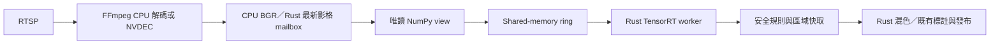

🇬🇧 [English (UK)](./README.md) | 🇹🇼 [繁體中文（台灣）](./README-zh-tw.md)

# Rust 後處理後端

這個 PyO3 擴充已接入 `main.py` 的攝影機處理流程，處理 centroid 追蹤、PPE
計數及人員與機具／車輛的距離判斷。數值運算期間釋放 GIL，直接交換 Python
list／dict，不使用逐格 JSON 或子程序 IPC。每個攝影機各自持有追蹤狀態。
追蹤與危害判定的 Rust 核心和獨立攝影機流程共用。 [共用 crate](../../../native/postprocess-core/Cargo.toml)

交通錐與電線桿多邊形保留既有幾何演算法，加入區域快取與 Rust MST 選邊；
文字與多邊形混色也有 Rust kernel。串流編碼、儲存及通知沿用既有實作。
幾何分析套件按需載入；
YOLO／TensorRT 推論可獨立選用 [Rust GPU worker](../../../native/inference/README-zh-tw.md)。
這不是整個服務的 Rust 重寫；Hungarian tracker 使用原本的 Python detector。
Rust detector 的追蹤狀態由擴充持有，不同步至 Python 的 `remote_tracks`／
`next_remote_id` 內部欄位。

## 建置與切換

使用專案 Python 3.15、Rust 1.93.1 及 C linker，在 repo 根目錄執行：

```bash
uvx --python 3.15 --from maturin==1.16.0 maturin build --release --locked \
  --manifest-path bindings/python/postprocess/Cargo.toml --out bindings/python/postprocess/dist
uv pip install --python /path/to/python3.15 --reinstall bindings/python/postprocess/dist/*.whl
```

`POSTPROCESS_BACKEND` 在攝影機程序啟動時驗證，變更後需要重啟：

| 值 | 行為 |
| --- | --- |
| `auto`（預設） | 已安裝 wheel 時選 Rust，未安裝時選 Python |
| `python` | 固定使用原本的 Python 實作 |
| `rust` | 要求 Rust wheel；未安裝時啟動失敗 |

初始化會記錄選用後端。損壞的擴充、缺少匯出函式或 ABI 版本不符都會報錯；
不會在追蹤途中更換後端並遺失 ID。擴充拒絕非有限數值；有效 YOLO 輸入及各項
警報輸出透過參考 Python 實作比對。

根目錄 Dockerfile 在獨立 stage 建置 wheel，串流映像自動安裝；最終映像不含
Rust 編譯工具。既有 API 映像不需要此擴充。可以單獨測試建置：

```bash
docker build --target rust-postprocess-wheel -t chd-native-wheel .
```

## 驗證與量測

```bash
export PYO3_PYTHON=/path/to/python3.15
cargo test --locked --features extension-module --lib \
  --manifest-path bindings/python/postprocess/Cargo.toml
cargo test --locked --manifest-path native/postprocess-core/Cargo.toml
PYTHON_DOTENV_DISABLED=1 python -m pytest tests/src/native_postprocess_test.py \
  tests/src/danger_detector_test.py tests/src/yolo_detector_test.py tests/main_test.py
```

原生測試涵蓋追蹤匹配、過期與參數更新、推論失敗時的 frame age、攝影機狀態
隔離、32 組功能開關、多邊形、ID 型別、串流入口與資源釋放。CI 建置及安裝
wheel 後執行測試；本機沒有 wheel 時原生整合測試會標示 skip。

使用前一輪實驗的輸入，量測**實際 Python 呼叫 Rust 的路徑**：

```bash
PYTHON_DOTENV_DISABLED=1 OPENBLAS_NUM_THREADS=1 OMP_NUM_THREADS=1 \
  python -m scripts.benchmark_postprocess \
  --corpus experiments/rust_benchmark/data/corpus.json --rounds 7 --core 4 \
  --output outputs/native_postprocess_results.json
```

輸入產生方式見 [實驗說明](../../../experiments/rust_benchmark/README-zh-tw.md)。計時包含
追蹤、Python bbox 正規化、PPE／距離規則、PyO3 資料轉換和警報建構；每段計時
外重建 tracker，輪流先執行 Python／Rust，先比對所有輸出。輸入讀檔、初始化、
模型推論、幾何多邊形、影像 I/O、繪圖、編碼、儲存與通知未計入。

2026-11-16 本機整合量測（i7-14700、Python 3.15、同一 P-core、7 輪）：

| 輸入 | Python ms／格 | Rust ms／格 | 每輪加速比中位數 |
| --- | ---: | ---: | ---: |
| 58 格真實偵測 | 0.011477 | 0.003701 | 3.08× |
| 合成 16 物件 | 0.057088 | 0.014622 | 3.90× |
| 合成 64 物件 | 0.411279 | 0.096394 | 4.27× |
| 合成 256 物件 | 3.687042 | 0.810177 | 4.56× |

真實資料每格約節省 0.0078 ms；物件密集時節省較多。這支持先遷移 CPU 後處理，
尚未證明攝影機總吞吐量或 GPU 推論會有相同增益。

上述指令會將各輪數值、CPU affinity、Python 版本、輸入及原始碼 SHA256 寫至
`outputs/native_postprocess_results.json`。表中的加速比為各輪比值的中位數。

## 區域快取、MST 與混色

2026-11-17 的下一輪修改包含：

- 每個 detector 最多保留交通錐、電線桿各一筆區域快取。幾何座標與順序、
  HDBSCAN 物件／參數、幾何常數或建構函式改變時重新建立；人員每格重新判定。
  自訂 clusterer、可呼叫的 metric 與複雜參數保留逐格計算。
- Delaunay、權重計算與排序保留原本語意，Rust 批次進行 Kruskal 選邊，保留
  同權重候選順序。Shapely／GEOS 的 union、contains 及切線幾何繼續沿用。
- Rust BGRA 文字混色保留原本整數四捨五入與裁切行為；多邊形使用由 OpenCV
  產生的混色查表，減少逐次配置 fill／blended 影像。逐像素測試涵蓋所有 256 個
  alpha 值與多種 polygon alpha。
- 小型 polygon mask 快取上限 16 筆，每筆最多 64 KiB；較大 mask 不快取。
  混色查表上限 128 筆。這些 buffer 為唯讀，各語言輸出持有自己的影格。

`GEOMETRY_API_VERSION=1`、`OVERLAY_API_VERSION=1` 為增量介面，沿用
`POSTPROCESS_BACKEND`。舊 wheel 缺少能力時走既有 Python 路徑；宣告能力
卻缺少對應函式則報錯。可變影像 kernel 持有 GIL，檢查 dtype、形狀、連續性、
唯讀狀態與輸入／輸出 alias，沒有讓可變 NumPy buffer 跨 GIL 邊界。

同一 P-core、7 輪交錯量測，相較本輪修改前的 Rust 整合版本：

| 階段 | 修改前 ms | 修改後 ms | 每輪加速比中位數 |
| --- | ---: | ---: | ---: |
| 1080p 推論，batch 1，單張 | 1.8662 | 1.7955 | 1.03× |
| 1080p 推論，batch 8，單張 | 1.0315 | 0.9321 | 1.11× |
| 固定交通錐／電線桿區域，34 名人員，單格 | 1.8760 | 0.3244 | 5.78× |
| 1080p 中文標註，12 框與區域填色，單格 | 3.5993 | 1.5609 | 2.31× |

區域、警報及標註像素輸出一致。幾何加速包含快取效益，場景或設定改變會重算；
標註量測使用每格重繪，涵蓋的工作與按需繪圖的直播流程有所不同。
量測使用基準版本的來源快照及兩個已安裝的原生擴充目錄。以下命令準備測試輸入，
再輸出各輪結果與來源 hash。

```bash
python experiments/rust_trt_benchmark/benchmark.py --prepare
python -m scripts.benchmark_native_pipeline --baseline /path/to/before \
  --baseline-wheel /path/to/baseline-extension-install \
  --current-wheel /path/to/current-extension-install \
  --output outputs/native_pipeline_benchmark.json
```

## 可選的 Rust 擷取後端

`LatestCapture` 由 Rust 管理 FFprobe／FFmpeg、解碼執行緒、影格所有權與容量為
1 的 latest-frame mailbox。FFmpeg 負責實際解碼，慢速消費時淘汰未取用的舊影格。
Python 接收 Rust `Arc<Vec<u8>>` 支撐的唯讀 NumPy view，沒有額外 bytes 快照；
消費中的影格不會被重用，擷取關閉後其既有 view 仍然有效。



更新 wheel 後明確選用，預設仍為 `opencv`：

```dotenv
STREAM_CAPTURE_BACKEND=rust_ffmpeg
STREAM_CAPTURE_DECODER=cpu
STREAM_CAPTURE_FFMPEG_PATH=ffmpeg
STREAM_CAPTURE_FFPROBE_PATH=ffprobe
```

`STREAM_CAPTURE_DECODER=cuda` 要求 FFmpeg 的 CUDA decoder 與相容 GPU。
已測試 8-bit H.264 NVDEC；目前 `hwdownload` 成 NV12 後轉 CPU BGR，再沿用
既有 shared-memory IPC。這個版本尚未實作 device-buffer IPC／完整 GPU
零拷貝，也沒有證明 32 路 CUDA 解碼的持續容量或主機資源節省。

rawvideo bridge 不提供來源 PTS，既有來源時間戳 watchdog 因而停用；讀取逾時、
重連退避與可選的視覺凍結偵測仍有效。靜態場景若無來源 PTS，可設定
`STREAM_CAPTURE_FREEZE_RECONNECT_SECONDS=0`，由讀取逾時判斷斷線。
關閉會停止並回收 decoder 程序、喚醒等待者及 join reader；網路工具輸出不直接
寫入服務 log。固定輸出尺寸，來源尺寸變更後由 FFmpeg scale 維持目前尺寸，
重連時重新探測。

隔離本機 MediaMTX、單一測試影片發布者與 32 個獨立 RTSP 訂閱完成 3 輪、
96 次擷取到共用 GPU worker 的請求；96 格全部走借用共享影格、快照 bytes=0，
worker 未載入 PyTorch。另驗證單一路 CUDA 解碼、舊影格淘汰及關閉後 view
有效。下方命令執行功能與生命週期測試，並寫出驗證結果。

```bash
python -m scripts.validate_native_capture \
  --engine /path/to/compatible/best_yolo26n.engine --cuda \
  --output outputs/native_capture_validation.json
```

此命令只使用本機測試影片，建立隨機 localhost port 的獨立容器，結束後清除。
