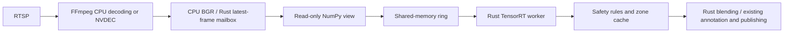

🇬🇧 [English (UK)](./README.md) | 🇹🇼 [繁體中文（台灣）](./README-zh-tw.md)

# Rust postprocessing backend

This PyO3 extension handles centroid tracking, PPE counts and proximity between people and machinery or vehicles in the `main.py` camera pipeline. It releases the GIL for numerical work and exchanges Python lists and dictionaries directly, without per-frame JSON or subprocess IPC. Each camera keeps its own tracking state. The standalone camera pipeline shares the same Rust tracking and hazard rules. [Shared crate](../../../native/postprocess-core/Cargo.toml)

Cone and utility-pole polygons use the existing geometry algorithms, zone caching and Rust minimum spanning tree (MST) edge selection. Rust kernels also blend text and polygons. Encoding, storage and notifications use the existing implementations. Geometry libraries load on demand, and YOLO/TensorRT inference can select the [Rust GPU worker](../../../native/inference/README.md) independently. The Hungarian tracker still uses the Python detector. The Rust extension owns its own tracks, independently of Python's internal `remote_tracks` and `next_remote_id`.

## Build and backend selection

From the repository root, build with the project's Python 3.15, Rust 1.93.1 and a C linker.

```bash
uvx --python 3.15 --from maturin==1.16.0 maturin build --release --locked \
  --manifest-path bindings/python/postprocess/Cargo.toml --out bindings/python/postprocess/dist
uv pip install --python /path/to/python3.15 --reinstall bindings/python/postprocess/dist/*.whl
```

The camera process validates `POSTPROCESS_BACKEND` at startup. Restart it after changing the setting.

| Value | Behaviour |
| --- | --- |
| `auto` (default) | Uses Rust when the wheel is installed and Python otherwise |
| `python` | Uses the existing Python implementation |
| `rust` | Requires the Rust wheel and fails at startup if it is missing |

Initialisation logs the selected backend. A broken extension, a missing export or an ABI mismatch raises an error. The backend stays fixed while tracking to preserve IDs. The extension rejects non-finite numbers. Tests compare valid YOLO inputs and alert outputs against the Python reference.

The root Dockerfile builds the wheel in a separate stage and installs it in the streaming image. The final image excludes the Rust compiler toolchain. The existing API image runs without the extension. To test the wheel build alone, run the following command.

```bash
docker build --target rust-postprocess-wheel -t chd-native-wheel .
```

## Verification and measurements

```bash
export PYO3_PYTHON=/path/to/python3.15
cargo test --locked --features extension-module --lib \
  --manifest-path bindings/python/postprocess/Cargo.toml
cargo test --locked --manifest-path native/postprocess-core/Cargo.toml
PYTHON_DOTENV_DISABLED=1 python -m pytest tests/src/native_postprocess_test.py \
  tests/src/danger_detector_test.py tests/src/yolo_detector_test.py tests/main_test.py
```

Native tests cover track matching and expiry, parameter updates, frame age after inference failure, camera isolation, all 32 feature-flag combinations, polygons, ID types, the streaming entry point and resource release. CI builds and installs the wheel before testing. Native integration tests are skipped locally when the wheel is absent.

The benchmark measures **Python calling the Rust extension** with inputs from the previous experiment.

```bash
PYTHON_DOTENV_DISABLED=1 OPENBLAS_NUM_THREADS=1 OMP_NUM_THREADS=1 \
  python -m scripts.benchmark_postprocess \
  --corpus experiments/rust_benchmark/data/corpus.json --rounds 7 --core 4 \
  --output outputs/native_postprocess_results.json
```

Timing covers tracking, bounding-box normalisation in Python, PPE and proximity rules, PyO3 conversions and alert construction. The benchmark compares all outputs first, rebuilds the tracker outside each timed interval and alternates the order of the backends. Timings exclude reading input, initialisation, model inference, polygon geometry, image I/O, drawing, encoding, storage and notifications. [Preparing the input](../../../experiments/rust_benchmark/README.md)

Local integration measurements on 16 November 2026 used an i7-14700, Python 3.15, a single P-core and seven rounds.

| Input | Python ms/frame | Rust ms/frame | Median paired speed-up |
| --- | ---: | ---: | ---: |
| 58 frames of real detections | 0.011477 | 0.003701 | 3.08× |
| Synthetic, 16 objects | 0.057088 | 0.014622 | 3.90× |
| Synthetic, 64 objects | 0.411279 | 0.096394 | 4.27× |
| Synthetic, 256 objects | 3.687042 | 0.810177 | 4.56× |

Real detections saved approximately 0.0078 ms per frame, with larger absolute savings for dense scenes. This result applies to the CPU postprocessing stage. Camera throughput and GPU inference require separate measurements.

The command writes individual round results, CPU affinity, the Python version and SHA-256 hashes of inputs and source to `outputs/native_postprocess_results.json`. Speed-up is the median ratio across paired rounds.

## Zone caching, MST and blending

The changes measured on 17 November 2026 were as follows.

- Each detector caches up to one zone for cones and one for poles. It rebuilds a zone when the geometry coordinates or order, HDBSCAN object or parameters, geometry constants or construction function change. People are checked on every frame. Custom clusterers, callable metrics and complex parameters retain per-frame calculation.
- Delaunay triangulation, weighting and sorting use the existing semantics. Rust selects Kruskal edges in batches, retaining the order of candidates with equal weights. Shapely/GEOS still performs union, containment and tangent geometry.
- The Rust BGRA text kernel preserves integer rounding and clipping. Polygon blending uses a lookup table generated with OpenCV to reduce repeated allocation of filled and blended images. Pixel comparisons cover all 256 alpha values and multiple polygon alpha values.
- The polygon mask cache holds up to 16 entries of up to 64 KiB each. Larger masks bypass the cache. At most 128 blending tables are cached. The buffers are read-only and each language output owns its frame.

The additive interfaces `GEOMETRY_API_VERSION=1` and `OVERLAY_API_VERSION=1` use `POSTPROCESS_BACKEND`. With an older wheel, unavailable features use the existing Python path. A wheel that advertises a missing function raises an error. Kernels that modify images hold the GIL and check dtype, shape, contiguity, read-only state and aliasing between inputs and outputs. Mutable NumPy buffers stay within the GIL boundary.

These measurements compare the preceding Rust integration with the updated one, in seven alternating rounds on the same P-core.

| Stage | Before, ms | After, ms | Median paired speed-up |
| --- | ---: | ---: | ---: |
| 1080p inference, batch 1, per image | 1.8662 | 1.7955 | 1.03× |
| 1080p inference, batch 8, per image | 1.0315 | 0.9321 | 1.11× |
| Static cone/pole zones, 34 people, per frame | 1.8760 | 0.3244 | 5.78× |
| 1080p Chinese annotations, 12 boxes and zone fill, per frame | 3.5993 | 1.5609 | 2.31× |

Zones, alerts and overlay pixels matched. Geometry timings include cache hits. A change of scene or configuration triggers recalculation. The annotation benchmark redraws every frame, while live output draws on demand. Supply a baseline source snapshot and the two installed native extension directories. These commands prepare test inputs and write per-round measurements and source hashes.

```bash
python experiments/rust_trt_benchmark/benchmark.py --prepare
python -m scripts.benchmark_native_pipeline --baseline /path/to/before \
  --baseline-wheel /path/to/baseline-extension-install \
  --current-wheel /path/to/current-extension-install \
  --output outputs/native_pipeline_benchmark.json
```

## Optional Rust capture backend

`LatestCapture` manages FFprobe/FFmpeg, the decoder thread, frame ownership and a single-slot latest-frame mailbox in Rust. FFmpeg decodes. A slow consumer skips unclaimed older frames. Python receives a read-only NumPy view backed by a Rust `Arc<Vec<u8>>` without taking an additional byte snapshot. Frames in use are never overwritten, and views remain valid after capture closes.



To select the backend explicitly after updating the wheel, use the settings below. The default is `opencv`.

```dotenv
STREAM_CAPTURE_BACKEND=rust_ffmpeg
STREAM_CAPTURE_DECODER=cpu
STREAM_CAPTURE_FFMPEG_PATH=ffmpeg
STREAM_CAPTURE_FFPROBE_PATH=ffprobe
```

`STREAM_CAPTURE_DECODER=cuda` requires an FFmpeg CUDA decoder and a compatible GPU. The tested configuration used 8-bit H.264 NVDEC. It downloads NV12 with `hwdownload`, converts to BGR on the CPU and uses the existing shared-memory IPC. This version does not implement device-buffer IPC or a fully zero-copy GPU pipeline. Sustained 32-stream CUDA decoding capacity and host resource savings have yet to be established.

The rawvideo bridge supplies no source PTS, so the source timestamp watchdog is disabled. Read timeouts, reconnection back-off and optional visual freeze detection remain active. For static scenes without source PTS, set `STREAM_CAPTURE_FREEZE_RECONNECT_SECONDS=0` to rely on read timeouts to detect disconnection. Closing capture stops and reaps the decoder process, wakes waiting consumers and joins the reader. Raw network-tool output stays out of service logs. The output dimensions stay fixed: FFmpeg scales a changed source to the current size until reconnection probes it again.

One test-video publisher and 32 independent RTSP subscriptions on an isolated local MediaMTX instance completed three rounds and 96 capture-to-shared-GPU-worker requests. All 96 frames used borrowed shared memory with zero snapshot bytes, and the worker ran without loading PyTorch. Additional checks covered single-stream CUDA decoding, stale-frame eviction and view validity after shutdown. Run the following command to test these behaviours and write the results.

```bash
python -m scripts.validate_native_capture \
  --engine /path/to/compatible/best_yolo26n.engine --cuda \
  --output outputs/native_capture_validation.json
```

This command uses only local test video. It creates a separate container on a random localhost port and removes it when finished.
