🇬🇧 [English (UK)](./README.md) | 🇹🇼 [繁體中文（台灣）](./README-zh-tw.md)

# Shared Rust YOLO worker

`src/yolo_worker.py` supports Rust GPU inference as a production backend. It uses the existing camera shared-memory ring, latest-frame scheduling, per-model batching, per-camera reply queues, startup lock, catalogue permissions and SHA-256 verification of artefacts and manifests.

Each shared worker owns one engine per loaded model. Cameras assigned to it share that instance. Rust handles letterboxing, batch limits, detection filtering and coordinate restoration. A C++ bridge calls TensorRT and OpenCV. A CUDA kernel combines BGR-to-RGB conversion, HWC-to-CHW conversion and normalisation. The Rust path uses Python for worker control and existing IPC, without loading PyTorch or Ultralytics.

## Backend selection

| `YOLO_WORKER_BACKEND` | Behaviour |
| --- | --- |
| `auto` (default) | Selects Rust when a GPU wheel is available and the verified CUDA engine has a supported interface. Uses Python for other models. |
| `rust` | Requires the Rust GPU wheel and a compatible CUDA engine. Fails if either is unavailable. |
| `python` | Uses the existing Ultralytics inference path. |

`auto` selects Python at model initialisation if the wheel is absent or CPU-only, the model is not a CUDA engine, or the engine interface is explicitly unsupported. A broken wheel, an ABI or runtime mismatch, or an inference failure raises an error. Backend selection stays fixed for the model. Startup and model-loading logs identify the chosen backend.

A 32-camera deployment can reuse the existing worker pool groups.

```dotenv
YOLO_WORKER_BACKEND=rust
YOLO_WORKER_PRECISION=int8
YOLO_WORKER_BATCH_SIZE=8
YOLO_WORKER_BATCH_WAIT_MS=10
YOLO_WORKER_CAMERAS_PER_ENGINE_BY_MODEL=yolo26n=8,yolo26s=7,yolo26m=6,yolo26l=5,yolo26x=3
YOLO_WORKER_ARTIFACT_MANIFEST=/app/config/stream-engines.json
```

Use the published model catalogue and the actual engine manifest path. The catalogue's source weights and the derived engine in the manifest must pass verification. The worker does not select arbitrary files from `models/int8_engine`. Restart workers after changing the settings. Plain `.pt` and ONNX models use Python in `auto` mode and are rejected in `rust` mode. The worker does not export or requantise a model automatically.

The interface supports NCHW detection engines with FP32 **input and output** and NMS-free `[batch, boxes, 6]` output. Internal computation may use mixed INT8/FP16 precision. FP16 I/O, multiple outputs and models requiring additional NMS are unsupported. The engine's batch limit applies to each call. A larger worker batch is split while retaining the result count and original request order.

INT8 uses `rect=False` for fixed square input in both backends. Other settings can use rectangular inputs. The worker defaults are confidence 0.25 and a maximum of 300 detections.

## TensorRT versions and build

**The TensorRT headers used to build the Rust wheel, the installed runtime and the `.engine` must be compatible.** Initialisation checks header and runtime API versions. Deserialisation errors include TensorRT diagnostics.

The measurements below used a compatible TensorRT **11.1.0.106** SDK, runtime and engine. For deployment, select a runtime that can load the target engine and build the wheel with a matching SDK.

The root Dockerfile builds and installs the GPU wheel with the SDK version specified in `deploy/python315/bootstrap.py`, currently **11.4.0.106**. Docker deployments need a verified engine that this version can load. Verify compatibility before using a local 11.1 engine.

To build just the Docker wheel stage without starting any streams, run the following command.

```bash
docker build --target rust-inference-wheel -t chd-native-inference-wheel .
```

Standalone Rust applications use the crate's `core` and `engine` modules directly and can enable the `tensorrt` feature. The Python wheel is built from `bindings/python/inference` and exposes `construction_inference`. [Standalone camera pipeline](../pipeline/README.md)

To build the Python wheel on the host, use Rust 1.93.1, Python 3.15, a C++17 compiler, matching TensorRT headers and libraries, full CUDA toolkit headers, the CUDA runtime, driver and NVRTC, and the OpenCV core/imgproc headers and shared libraries. Set the paths for your installation.

```bash
export TRT_INCLUDE=/path/to/TensorRT-11.1/include
export TRT_LIB=/path/to/TensorRT-11.1/lib
export CUDA_INCLUDE=/path/to/cuda/include
export CUDA_LIB=/path/to/cuda/lib
export OPENCV_ROOT=/  # System installation. For an isolated installation, use its prefix.
export LD_LIBRARY_PATH="$TRT_LIB:$CUDA_LIB:$OPENCV_ROOT/usr/lib/x86_64-linux-gnu"

uvx --python 3.15 --from maturin==1.16.0 maturin build \
  --release --locked --auditwheel skip --features tensorrt \
  --manifest-path bindings/python/inference/Cargo.toml --out outputs/inference-wheels
uv pip install --python /path/to/python3.15 --reinstall \
  outputs/inference-wheels/*.whl
```

`--auditwheel skip` produces a platform wheel linked to the system libraries and avoids bundling the host's NVIDIA driver. The OpenCV runtime must match the SONAME used at build time. The Docker builder and runtime use the same Debian release and OpenCV packages.

CUDA and TensorRT libraries installed as Python packages are preloaded from site-packages. For a separate installation, set `YOLO_WORKER_NATIVE_LIBRARY_DIRS=/path/to/cuda/lib:/path/to/TensorRT/lib` to search those directories first, in order. OpenCV and other custom shared libraries must remain on the system loader's search path. Restart the process after changing a loaded runtime. Updating the Python bindings alone does not reload it.

Building without `--features tensorrt` creates a CPU-only wheel for CI without a GPU. It can verify the ABI and pure Rust algorithms. CUDA inference requires the GPU wheel.

## Resources and lifetime across cameras

The TensorRT context uses caller-managed activation memory. It allocates for the actual shapes used and retains the largest capacity reached. It changes buffers after synchronous inference completes and releases old storage before growing, so both reservations do not coexist. If allocation fails, the batch returns an error and invalidates the shape cache before an obsolete device pointer can be reused.

The shared frame interface uses `BUFFER_API_VERSION=1`. Python passes a read-only contiguous uint8 HWC buffer view. Rust reads it while holding the GIL, resizes and pads the frame, then releases the GIL for CUDA. Only **resized pixels owned by Rust** cross the GIL boundary. This removes the full-frame `tobytes()` snapshot while retaining resizing, padding and host-to-device transfer. Ordinary NumPy arrays, non-contiguous inputs and older wheels continue to use immutable byte snapshots.

The producer holds the slot lease until the worker replies. A timeout, cancellation or uncertain submission permanently retires the ring. Later frames use a new ring, and waiting writers revalidate the ring when they wake. After a grace period, only retired segments are reclaimed. Their slots are never rewritten. Workers that already mapped a segment can finish reading it. An expired request fails if the segment was unlinked before it opened the mapping.

An engine mutex serialises calls on each context. Stopping a worker or exiting its run loop on error closes its native engines and releases contexts, CUDA buffers, kernel modules and the model cache. Close is idempotent. Each model and worker has independent state.

Estimate resource use for 32 cameras from the actual number of workers. At eight cameras per YOLO26n worker there are four shared model instances. Distinguish per-process RSS, shared pages and physical host RAM. Multiplying one worker's RSS difference by 32 would overstate host savings.

## Tests and measurements

```bash
export PYO3_PYTHON=/path/to/python3.15
cargo test --locked --lib \
  --manifest-path native/inference/Cargo.toml
cargo test --locked --features extension-module --lib \
  --manifest-path bindings/python/inference/Cargo.toml
PYTHON_DOTENV_DISABLED=1 YOLO_WORKER_BACKEND=python python -m pytest \
  tests/src/native_inference_test.py tests/src/yolo_worker_test.py

# Set the local test model to run the GPU and 32-stream IPC integration tests.
CHD_NATIVE_TEST_ENGINE=/path/to/best_yolo26n.engine \
  PYTHON_DOTENV_DISABLED=1 python -m pytest \
  tests/src/native_inference_gpu_test.py
```

The GPU tests cover production square-input batches of 1 and 8, splitting larger batches to fit the engine, recovery after invalid inputs, repeated close and **32 simulated sources using real shared memory and independent queues for three rounds and 96 requests**. The isolated test catalogue verifies the engine's SHA-256 without accessing production databases, Redis or cameras. The Rust worker ran without loading PyTorch. All 96 frames used buffer views, with zero full-frame snapshot bytes. Tests also cover cancellation during queue submission, writers still waiting for slots when a ring is retired, and engine integrity after an invalid buffer.

The benchmark calls `YoloWorker._predict_batch` directly with the INT8 worker's `rect=False`. Timing includes the Python-to-Rust byte copy, constructing PyO3 results and converting the output.

Initial measurements with production settings and full-frame snapshots used an RTX 4090, TensorRT 11.1, 58 frames and seven rounds.

| Model | Batch | Python ms/image | Rust ms/image | Median paired speed-up |
| --- | ---: | ---: | ---: | ---: |
| yolo26n | 1 | 1.9865 | 1.3678 | 1.45× |
| yolo26n | 8 | 1.2970 | 0.5840 | 2.23× |
| yolo26s | 1 | 2.1565 | 1.6421 | 1.31× |
| yolo26s | 8 | 0.9356 | 0.6795 | 1.38× |

Confidence scores and classes matched exactly. The maximum coordinate difference in the original image was 0.000061 pixels. Peak per-process CPU RSS fell by approximately 51–53%. The Rust worker ran without loading PyTorch. The activation reservation fell by approximately 27–31%, depending on the model and batch. This measures reserved activation memory, not total GPU memory.

This comparison used Ultralytics 8.4.183 and PyTorch 2.15.0. Each speed-up is the median of the paired Python/Rust elapsed-time ratios. Use a compatible engine and Python environment to repeat it.

```bash
python experiments/rust_trt_benchmark/benchmark.py --prepare
PYTHON_DOTENV_DISABLED=1 OPENBLAS_NUM_THREADS=1 OMP_NUM_THREADS=1 \
  python -m scripts.benchmark_native_worker --models yolo26n yolo26s \
  --batches 1 8 --rounds 7 --core 4 \
  --output outputs/native_worker_benchmark.json
```

The input manifest uses local video and test images. The benchmark compares all outputs before running seven alternating rounds. Reading files, warm-up and JSON control messages are outside the timed interval. Results include CPU affinity, engine and source SHA-256 hashes, per-round timings, GPU state, per-process peak RSS and activation bytes.

## Reducing shared-frame snapshots

On 17 November 2026 the snapshot and buffer paths were compared in seven alternating rounds using the same YOLO26n engine on an RTX 4090 with fixed 640-square input. Eight frames from the test video were enlarged to 720p and 1080p and placed in shared memory before timing. Resizing the source, reading it from disk and creating the initial mapping were excluded.

| Input | Batch | Snapshot ms/image | Buffer ms/image | Median paired speed-up |
| --- | ---: | ---: | ---: | ---: |
| 720p | 1 | 1.7210 | 1.5611 | 1.10× |
| 720p | 8 | 1.1146 | 0.7172 | 1.56× |
| 1080p | 1 | 2.3247 | 1.8444 | 1.27× |
| 1080p | 8 | 1.8849 | 1.0266 | 1.84× |

Detection outputs were identical in each case. A 1080p frame avoided a full-frame snapshot of 6,220,800 bytes, or about 47.46 MiB for batch 8. These ratios compare two Rust paths. They cannot be multiplied directly by the earlier Python/Rust ratios.

This command records round timings, copy counts, source hashes and GPU state.

```bash
python -m scripts.benchmark_frame_buffers --rounds 7 --core 4 \
  --output outputs/frame_buffer_benchmark.json
```

## Loading geometry libraries on demand

`DangerDetector` now uses bounding-box normalisation from `src/bounding_boxes.py`, which has no geometry dependencies. The `src.geometry.normalise_bbox` import remains available. Shapely, SciPy and sklearn load lazily, and HDBSCAN is created only for zone checks. Fewer than three cones, absent utility poles or empty polygon coordinate conversions return early.

PPE and person-to-machinery proximity rules do not load these packages. The first actual geometry operation loads the same packages and uses the existing algorithm. Memory savings depend on the enabled rules and the scene. Alerts and polygon outputs matched the earlier implementation across 32 feature-flag combinations and 832 input cases.

Over five trials, a fresh process imported `src.stream_processor` and initialised 32 Rust PPE/proximity detectors. Local median startup time fell from 0.986 s to 0.454 s and median PSS from 186.23 MiB to 97.46 MiB, a reduction of approximately 88.77 MiB. Each trial used one fresh process without starting any cameras. PSS depends on shared system pages. Multiplying by 32 would not give a deployment RAM figure. Provide a snapshot of the original `src` directory to reproduce the comparison.

```bash
mkdir -p outputs
python -m scripts.benchmark_geometry_loading --baseline /path/to/before \
  --output outputs/geometry_loading_benchmark.json
```

## Buffer reuse and resizing

The Rust engine retains reusable host pixel and detection workspaces at their largest capacity. Letterboxing resizes into a region of the existing output buffer and fills its padding, eliminating the intermediate resized Mat. CUDA transfer and activation buffers retain their existing high-water allocation policy.

`workspace_growths` counts capacity increases in the two main host buffers. It stops growing once a fixed batch and shape have warmed up. `workspace_bytes` reports reusable host workspace capacity, which is only part of total engine memory. Each live prepared batch owns its pixels. It holds no borrowed NumPy memory across the GIL boundary. Interleaved calls can allocate separate workspaces while the mutex protects the context.

In seven rounds of 1080p YOLO26n with fixed 640-square inputs, batch 1 fell from approximately 1.8662 to 1.7955 ms/image, and batch 8 from 1.0315 to 0.9321 ms/image. [Postprocessing and shared-frame benchmark commands](../../bindings/python/postprocess/README.md)

A separate CUDA bilinear kernel compared uploading CPU-resized/padded frames with uploading the original frame and resizing on the GPU. Both reused buffers, included pageable host-to-device transfer and kept output on the GPU. The benchmark runs independently of the production engine. At 720p, the GPU candidate took approximately 0.281 ms against 0.330 ms on CPU, with a one-level pixel difference. At 1080p they took about 0.595 ms and 0.551 ms respectively.

The worker uses CPU resizing. Run the command below to reproduce the interpolation and latency comparison.

```bash
mkdir -p outputs
python -m scripts.benchmark_resize_candidates --output outputs/resize_candidate_benchmark.json
```

These results cover detection. Camera capture, decoding, worker IPC and queueing, tracking, drawing, encoding, storage and notifications are outside the timings. The 32-stream IPC test establishes functionality but does not measure end-to-end capacity for 32 real RTSP cameras. Measurements included existing GPU load. Recheck latency and utilisation for the actual deployment.

## Cross-process GPU resources and asynchronous inference

The existing worker supports resource quotas and lease lifetimes. GPU frame handling is available as a separate experiment. See the [configuration example](../../.env.example) and [settings ownership guide](../../src/settings/README.md).

| Feature | Implementation and setting | Scope |
| --- | --- | --- |
| Shared NVENC slots | Existing publishers and restreamers automatically use the Rust `ResourceLease`. | The Python fallback uses the same protocol. Participants on one physical GPU must share the directory, UID, namespace and limit. |
| Inference concurrency | `GPU_RESOURCE_INFERENCE_SLOTS`, disabled at 0. | Each Rust model call holds a lease until all CUDA work completes and all results have been collected. |
| Model memory budget | `GPU_RESOURCE_MEMORY_LIMIT_MB`, disabled at 0. | Each model declares `YOLO_WORKER_GPU_MEMORY_RESERVATION_MB`. It reserves memory before loading and releases it after closing the engine. |
| Asynchronous inference | `YOLO_WORKER_NATIVE_ASYNC=true`, off by default. | Uses pinned pixels and outputs, two sets of device I/O buffers, upload and compute streams, events and `enqueueV3`. |
| GPU frames and encoding | Wheel feature `gpu-media` with standalone `ExperimentalGpuMedia`. | Colour/detection parity with the existing path has yet to pass. This experiment runs separately from `StreamCapture` and the production publisher. |

Rust file-lock leases coordinate GPU quotas without a persistent service. A mixed Rust/Python test with 32 processes requesting six slots admitted exactly six and reclaimed slots after a crash. FFmpeg subprocesses inherit the same lease via `pass_fds` so that an encoder still running after its controller exits counts towards the limit. Forked children close descriptors they did not acquire. Failure to acquire all requested memory units rolls back the entire reservation.

Compose supplies the `gpu-resource-locks` named volume. Camera processes and replicas in the same project share `/app/outputs/gpu-resources`. Host processes and other Compose projects must point to the same physical directory. Separate container `/tmp` directories create separate quotas. `GPU_RESOURCE_DEVICE_ID` must identify the physical GPU independently of `CUDA_VISIBLE_DEVICES` logical numbering. An incompatible quota request is rejected while the previous quota is in use. Stop participants before changing the quota and keep active lock files in place. NVENC continues to use `MEDIA_NVENC_MAX_SESSIONS`.

Enabling inference or memory limits requires `YOLO_WORKER_BACKEND=rust` to prevent automatic fallback from bypassing enforcement. Each memory reservation rounds up to 64 MiB and the total budget rounds down. Include the engine, activations and maximum shape/batch buffers in the declared reservation and leave headroom. The budget excludes other CUDA processes, API workloads, NVDEC, GPU colour LUTs and frames, and pinned RAM. Out-of-memory failures remain possible. Inference limits give no priority or cross-process fairness guarantees.

The optional asynchronous worker uses one TensorRT execution context. One compute stream executes in order while a separate upload stream can overlap the next batch transfer with the current computation. Two outstanding tickets each retain their pinned buffers until collection. Shape changes drain pending work. Close waits for the GPU before releasing the context and storage. Calls never use the same context concurrently.

`YOLO_WORKER_NATIVE_MICRO_BATCH_SIZE=0` uses the engine capacity. With a worker batch of 8 and microbatch of 4, one request submits two batches. Smaller batches can reduce TensorRT efficiency. A single submit/collect pair has no second batch with which to overlap.

The synchronous and asynchronous tests used an RTX 4090 and YOLO26n INT8 with leased 1080p shared-memory frames, 16 frames per request and fixed 640-square input. Each microbatch size was compared against the same synchronous size in five alternating rounds of 50 requests per mode. Timings cover inference requests, exclude warm-up and file I/O and include the existing GPU load.

| Microbatch | Synchronous ms/image | Asynchronous ms/image | Median paired speed-up | Asynchronous pinned RAM |
| --- | ---: | ---: | ---: | ---: |
| 1 | 1.8152 | 1.7263 | 1.040× | 2.36 MiB |
| 8 | 0.9475 | 0.9976 | 0.952× | 18.86 MiB |

All detection values matched. Asynchronous mode defaults to off. Before enabling it for 32 streams, measure with the actual batch size, queuing latency, CPU, VRAM, pinned RAM and deployment load.

```bash
mkdir -p outputs
python -m scripts.benchmark_async_inference --rounds 5 --repeats 50 \
  --output outputs/async_inference_benchmark.json
```

## GPU frames, annotations and the NVENC experiment

```mermaid
flowchart LR
    A[PyAV / FFmpeg NVDEC] --> B[CUDA NV12 planes]
    B --> C[Rust GPU frame ownership<br/>D2D import + stream barrier]
    C --> D[GPU colour conversion / integer rescaling / normalisation]
    D --> E[TensorRT enqueueV3]
    E --> F[Small detection results to CPU]
    F --> G[Small BGRA glyph uploads]
    C --> H[GPU frame copy + alpha blend]
    G --> H
    H --> I[GPU BGR to NV12]
    I --> J[FFmpeg h264_nvenc<br/>device frame input]
    J --> K[Compressed H264 bytes to host]
```



Rust's `GpuFrame` accepts typed frames, checks the DLPack dtype, shape, stride and CUDA device, and uses a device-to-device copy to obtain ownership. Pending inference and NVENC retain an image reference. The caller can close early, but must copy the frame before changing it while a reference is held. libavcodec passes a CUDA `AVFrame` to NVENC without a CPU rawvideo pipe. The CPU receives detection results and compressed streams and uploads small box and text patches.

The GPU still copies frames and converts colours. PyAV 17.1's CUDA plane DLPack lacks a producer-stream handshake, so import requires device-wide synchronisation. Multi-camera concurrency gains are therefore unproven. A colour LUT takes about 48 MiB per profile, with up to two cached profiles. Frames are allocated individually. There is no GPU pool yet. Preprocessing only accepts pixel-aligned, aspect-preserving integer reductions. Other scales and enlargement are rejected to preserve interpolation behaviour.

For both the 640×352 local test video and its 1920×1080 version, 32 frames completed decoding, inference, box/text blending, NVENC encoding and decoding again. Full-frame download bytes and inference-image H2D bytes were both zero on the hot path. These counters exclude prior colour diagnostic downloads, glyph uploads and compressed bitstreams. GPU alpha blending matched integer CPU blending pixel for pixel. With identical BGR input, CPU-fed and device-fed engine outputs matched.

**The experimental path has yet to match the existing pipeline.** Compared with the original swscale BGR output, the maximum pixel-level difference was 58 at 640×352 and 22 at 1080p, and detections differed. Even the POINT profile differed by two and three levels respectively. Keep the GPU frame path as a separate experiment. The commands below report the results for both sizes.

Python 3.15 uses the existing PyAV/FFmpeg installation without adding PyNvVideoCodec. The FFmpeg, CUDA and TensorRT headers and runtimes must be compatible. Compiling the optional feature leaves activation of this experimental path explicit.

```bash
# Debian/Ubuntu additionally needs libavcodec-dev and libavutil-dev.
python -m scripts.build_native_inference --output /tmp/wheels --gpu-media
# Docker's default wheel keeps the media feature disabled:
docker build --build-arg NATIVE_GPU_MEDIA=1 -t chd-gpu-media .

python -m scripts.validate_gpu_media --engine /path/to/compatible.engine \
  --report outputs/gpu_media_results.json
ffmpeg -i tests/videos/test.mp4 -vf scale=1920:1080:flags=bilinear \
  -frames:v 33 -c:v libx264 -preset ultrafast /tmp/chd-gpu-input1080.mp4
python -m scripts.validate_gpu_media --engine /path/to/compatible.engine \
  --video /tmp/chd-gpu-input1080.mp4 \
  --output outputs/native_gpu_1080_test.h264 \
  --report outputs/gpu_media_1080_results.json
```

## Standalone Rust preprocessing pool

The Rust API `NativeEngine::prepare_images_parallel` accepts a bounded Rayon pool shared by the caller. Every image gets an exclusive output slice. It uses the existing `ci_letterbox` implementation and OpenCV INTER_LINEAR. CPU work carries no CUDA context. All models in `native/pipeline` share `preprocess_workers` threads and submit to the engine after preparation. The Python worker's default path stays sequential. A batch of one provides no opportunity for parallelism across images.

Use a compatible CUDA/TensorRT runtime and put the test engine at `models/int8_engine/best_yolo26n.engine`. The following test compares preprocessing byte for byte across Full HD and mixed-size frames, rectangular mode and different thread counts.

```bash
cargo test --locked --features tensorrt --lib \
  --manifest-path native/inference/Cargo.toml \
  full_hd_parallel_preprocess_is_byte_exact_at_every_pool_size -- --ignored
```
