# Rust 共用 YOLO worker

Rust GPU 推論已接入 `src/yolo_worker.py`，從實驗程式提升為可選用的正式後端。
保留現有 camera shared-memory ring、latest-frame 排程、同模型批次、每鏡頭回覆
queue、startup lock、catalog 權限與 artifact／manifest SHA256 驗證。

每個共用 worker 的每個已載入模型持有一個 engine，攝影機不各自建立模型。
Rust 負責 letterbox、批次邊界、偵測篩選與座標還原，C++ bridge 呼叫 TensorRT／
OpenCV，CUDA kernel 合併 BGR→RGB、HWC→CHW 與正規化。Rust 路徑不載入
PyTorch 或 Ultralytics；Python 只保留 worker 控制與原有 IPC。

## 啟用與切換

| `YOLO_WORKER_BACKEND` | 行為 |
| --- | --- |
| `auto`（預設） | GPU wheel 可用且已驗證的 CUDA engine 符合介面時選 Rust；其他模型走 Python |
| `rust` | 要求 Rust GPU wheel 與符合介面的 CUDA engine，不接受靜默切換 |
| `python` | 使用原本的 Ultralytics 推論路徑 |

`auto` 只在 wheel 未安裝、CPU-only wheel、非 CUDA engine 或明確不支援的
模型介面時，於模型初始化選 Python。損壞的 wheel、ABI／runtime 版本錯誤及
推論失敗會回報錯誤，沒有逐格切換後端。啟動與載入模型的 log 會顯示後端。

32 路部署可以使用既有 worker pool 分組，例如：

```dotenv
YOLO_WORKER_BACKEND=rust
YOLO_WORKER_PRECISION=int8
YOLO_WORKER_BATCH_SIZE=8
YOLO_WORKER_BATCH_WAIT_MS=10
YOLO_WORKER_CAMERAS_PER_ENGINE_BY_MODEL=yolo26n=8,yolo26s=7,yolo26m=6,yolo26l=5,yolo26x=3
YOLO_WORKER_ARTIFACT_MANIFEST=/app/config/stream-engines.json
```

使用已發布的 model catalog 與真實的 engine manifest 路徑。Rust 不會從
`models/int8_engine` 任意挑檔；catalog 原始權重及 manifest 衍生 engine 都要
先通過既有驗證。設定變更後需重啟 worker。純 `.pt`／ONNX 模型在 `auto` 走
Python，`rust` 則拒絕；不會自動匯出或重新量化。

初版支援 NCHW、FP32 **I/O**、NMS-free `[batch, boxes, 6]` 的 detection engine；
內部可以是目前的混合 INT8／FP16 計算。FP16 I/O、多輸出與需額外 NMS 的模型
屬明確不支援介面。engine 的 batch 上限會限制每次呼叫，較大的 worker batch
會拆批，回傳順序與數量仍須對應原始請求。

目前 INT8 precision 使用 `rect=False`，固定方形輸入；Rust 套用同一個設定。
其他既有設定仍可使用矩形模式。confidence=0.25、max_det=300 與 worker 預設一致。

## TensorRT 版本與建置

**Rust wheel 的 TensorRT headers、執行時的 runtime，以及 `.engine` 必須相容。**
初始化會驗證 headers／runtime API 版本，反序列化錯誤包含 TensorRT 診斷。

以下量測使用相容的 TensorRT **11.1.0.106** SDK、runtime 與 engine。部署時
選用可載入目標 engine 的 runtime，再以相容的 SDK 建置 Rust wheel。

根目錄 Dockerfile 會建置及安裝 GPU wheel，其 SDK 版本取自
`deploy/python315/bootstrap.py`，目前為 **11.4.0.106**。Docker 部署也需要
該版本可載入的已驗證 engine；不能直接把本機 11.1 engine 當成相容檔案。

只驗證 Docker wheel 建置，不啟動串流：

```bash
docker build --target rust-inference-wheel -t chd-native-inference-wheel .
```

獨立 Rust 程式直接引用此 crate 的 `core` 與 `engine`，並按需啟用 `tensorrt`。既有 Python wheel 由 `bindings/python/inference` 建置，繼續提供 `construction_inference` 模組。完整攝影機入口見 [native/pipeline](../pipeline/README.md)。

主機建置 Python wheel 需要 Rust 1.93.1、Python 3.15、C++17 compiler、matching TensorRT
headers／libraries、完整 CUDA toolkit headers、CUDA runtime／driver／NVRTC，
以及 OpenCV core／imgproc 的 headers 與共享函式庫。設定路徑後：

```bash
export TRT_INCLUDE=/path/to/TensorRT-11.1/include
export TRT_LIB=/path/to/TensorRT-11.1/lib
export CUDA_INCLUDE=/path/to/cuda/include
export CUDA_LIB=/path/to/cuda/lib
export OPENCV_ROOT=/  # 系統安裝；隔離安裝可填其 prefix
export LD_LIBRARY_PATH="$TRT_LIB:$CUDA_LIB:$OPENCV_ROOT/usr/lib/x86_64-linux-gnu"

uvx --python 3.15 --from maturin==1.16.0 maturin build \
  --release --locked --auditwheel skip --features tensorrt \
  --manifest-path bindings/python/inference/Cargo.toml --out outputs/inference-wheels
uv pip install --python /path/to/python3.15 --reinstall \
  outputs/inference-wheels/*.whl
```

`--auditwheel skip` 保留系統共享函式庫依賴，避免把主機 NVIDIA driver 打包到
wheel；產物是平台 wheel。OpenCV runtime 必須與建置時的 SONAME 相容。
Docker builder／runtime 使用同一 Debian 發行版及 OpenCV 套件。

pip 安裝的 CUDA／TensorRT library 會從 Python site-packages 預載。獨立安裝
可設定 `YOLO_WORKER_NATIVE_LIBRARY_DIRS=/path/to/cuda/lib:/path/to/TensorRT/lib`，
指定順序優先。OpenCV 及其他自訂共享函式庫仍須在系統 loader 搜尋路徑。
只有 Python bindings 改版不足以切換已載入的 runtime，必須重啟程序。

沒有 `--features tensorrt` 的建置是供無 GPU CI 使用的 CPU-only wheel；它能
驗證 ABI 與純 Rust 演算法，不能進行 CUDA 推論。

## 多鏡頭資源及生命週期

TensorRT context 使用 user-managed activation memory，按已使用的實際 shape
配置並保留高水位容量。同步推論完成後才能換 buffer；成長時先釋放舊 storage，
避免舊／新 activation 暫時並存。配置失敗會使該批回報錯誤，shape cache 先失效，
不會沿用已失效的裝置指標。

worker 的共享影格使用 `BUFFER_API_VERSION=1`：Python 傳入唯讀、連續的
uint8 HWC buffer view，Rust 在持有 GIL 時直接讀取並完成縮放／補邊，
只讓 **Rust 自有的縮放後像素**跨越 GIL 邊界，再釋放 GIL 執行 CUDA。
這省去原始整張影格的 `tobytes()` 快照；縮放、補邊與 host→device 傳輸仍存在。
一般 NumPy array、非連續輸入或舊版 wheel 繼續使用 immutable bytes 快照。

producer 的 slot lease 保留到 worker 回覆。逾時、取消或不確定是否完成的
提交會永久停用原 ring，後續影格配置新 ring；等待 slot 的 writer 醒來時也會
重新驗證 ring。寬限期到達後只回收已停用的 segment，不會重新寫入其 slot。
已開啟映射的 worker 可繼續讀取；尚未開啟且已被 unlink 的過期請求會回報錯誤。

engine mutex 保證同一 context 的呼叫不重疊。worker 停止或 run loop
異常時關閉 native engine，釋放 context、CUDA buffers、kernel module 與模型快取。
關閉可重複呼叫；每個模型／worker 的狀態獨立。

32 鏡頭的資源節省應按實際 worker 數量估算。以每個 YOLO26n worker 分配
8 鏡頭為例，是 4 個共用模型實例；記憶體數字還需區分單程序 RSS、共用頁面
與實際主機 RAM，不能把每 worker 的 RSS 差值直接乘 32。

## 測試及量測

```bash
export PYO3_PYTHON=/path/to/python3.15
cargo test --locked --lib \
  --manifest-path native/inference/Cargo.toml
cargo test --locked --features extension-module --lib \
  --manifest-path bindings/python/inference/Cargo.toml
PYTHON_DOTENV_DISABLED=1 YOLO_WORKER_BACKEND=python python -m pytest \
  tests/src/native_inference_test.py tests/src/yolo_worker_test.py

# 明確指定本機測試模型，才會執行 GPU／32 路 IPC 整合測試。
CHD_NATIVE_TEST_ENGINE=/path/to/best_yolo26n.engine \
  PYTHON_DOTENV_DISABLED=1 python -m pytest \
  tests/src/native_inference_gpu_test.py
```

GPU 測試包含正式方形輸入的 batch 1／8、engine capacity 拆批、錯誤輸入後的
狀態、重複關閉，以及 **32 路模擬來源、真實 shared memory／獨立 queue、3 輪
共 96 次請求**。使用隔離的測試 catalog，仍驗證真實 engine SHA256，不讀正式
資料庫、Redis 或攝影機。測試也確認 Rust worker 沒有載入 PyTorch，96 格全部
使用 buffer view，完整影格快照位元組數為零。另測試取消發生在 queue 提交途中、
停用 ring 時仍在等 slot 的 writer，以及失效 buffer 不會破壞 engine 狀態。

效能量測直接呼叫 `YoloWorker._predict_batch`，包含 Python→Rust bytes 拷貝、
PyO3 結果建構及結果轉換，使用 INT8 worker 的 `rect=False` 設定。

第一輪正式設定量測，含完整影格快照（RTX 4090、TensorRT 11.1、58 格、7 輪）：

| 模型 | Batch | Python ms／張 | Rust ms／張 | 每輪加速比中位數 |
| --- | ---: | ---: | ---: | ---: |
| yolo26n | 1 | 1.9865 | 1.3678 | 1.45× |
| yolo26n | 8 | 1.2970 | 0.5840 | 2.23× |
| yolo26s | 1 | 2.1565 | 1.6421 | 1.31× |
| yolo26s | 8 | 0.9356 | 0.6795 | 1.38× |

confidence／類別完全一致，原圖座標最大誤差 0.000061 pixel。單程序 CPU 峰值
RSS 約降低 51～53%；Rust worker 不載入 PyTorch。activation reservation 依
模型與 batch 約降低 27～31%，不是整張 GPU 的總顯存差值。

本次對照使用 Ultralytics 8.4.183 和 PyTorch 2.15.0。加速比中位數由各輪
Python／Rust 耗時比值計算。使用相容的 engine 與 Python 環境重跑量測。

```bash
python experiments/rust_trt_benchmark/benchmark.py --prepare
PYTHON_DOTENV_DISABLED=1 OPENBLAS_NUM_THREADS=1 OMP_NUM_THREADS=1 \
  python -m scripts.benchmark_native_worker --models yolo26n yolo26s \
  --batches 1 8 --rounds 7 --core 4 \
  --output outputs/native_worker_benchmark.json
```

輸入 manifest 使用本機測試影片與圖片。先比對全部輸出，再執行交錯 7 輪；暖機、讀檔與
JSON 控制訊息不計時。CPU affinity、engine／source SHA256、各輪耗時、
GPU 狀態、單程序 peak RSS 與 activation bytes 都保存在結果。

## 共享影格快照減量

2026-11-17 使用同一個 YOLO26n engine、RTX 4090、固定 640 方形輸入，
對交錯執行的快照／buffer 路徑量測 7 輪。8 格測試影片影像預先放大為
720p／1080p 並寫入共享記憶體；放大、讀檔及初次映射不計時。

| 輸入 | Batch | 快照 ms／張 | Buffer ms／張 | 每輪加速比中位數 |
| --- | ---: | ---: | ---: | ---: |
| 720p | 1 | 1.7210 | 1.5611 | 1.10× |
| 720p | 8 | 1.1146 | 0.7172 | 1.56× |
| 1080p | 1 | 2.3247 | 1.8444 | 1.27× |
| 1080p | 8 | 1.8849 | 1.0266 | 1.84× |

每個 case 的偵測輸出完全相同。1080p 每格省去 6,220,800 bytes 的完整影格快照；
batch 8 約少 47.46 MiB 的快照資料。這是相對於先前 Rust 快照路徑的改善，
不能把這裡的倍數直接乘上第一輪 Python／Rust 比值。

以下命令輸出各輪耗時、複製計數、來源 hash 及 GPU 狀態。

```bash
python -m scripts.benchmark_frame_buffers --rounds 7 --core 4 \
  --output outputs/frame_buffer_benchmark.json
```

## 幾何套件按需載入

`DangerDetector` 的 bbox 正規化移至不含幾何相依的 `src/bounding_boxes.py`；
原本 `src.geometry.normalise_bbox` 的匯入介面仍保留。Shapely、SciPy、sklearn
改為 lazy import，HDBSCAN 直到需要檢查區域時才建立；少於三個交通錐、
沒有電線桿，以及空的多邊形座標轉換都提前返回。

PPE／人員與機具距離規則不會觸發這些套件。第一次實際使用幾何功能時仍會
載入原本套件並執行既有演算法；因此記憶體效益取決於各鏡頭啟用的規則與影像內容。
32 組功能開關、共 832 組輸入的警報與多邊形輸出，與修改前完全一致。

測試讓新程序匯入 `src.stream_processor`，並初始化 32 個 Rust PPE／距離 detector，
共執行五輪對照。
本機啟動耗時中位數由 0.986 秒降至 0.454 秒；PSS 中位數由 186.23 MiB
降至 97.46 MiB，約少 88.77 MiB。
每輪是單一新程序，沒有啟動攝影機；PSS 受系統共用頁面影響，不能直接乘 32
當成實際部署的 RAM 節省。重現時提供修改前的 `src` 目錄快照：

```bash
mkdir -p outputs
python -m scripts.benchmark_geometry_loading --baseline /path/to/before \
  --output outputs/geometry_loading_benchmark.json
```

## 後續 buffer 重用與 resize 評估

Rust engine 再加入 host 像素與偵測輸出 workspace 的高水位重用。letterbox
直接縮放到既有輸出 buffer 的 ROI，填入四周 padding，不再配置中間 resized Mat。
CUDA 傳輸／activation buffer 延續原本的高水位管理。

`workspace_growths` 記錄兩個主要 host buffer 的容量成長次數；固定 batch／shape
暖機後不再增加。`workspace_bytes` 是可重用 host workspace 容量，並非 engine
總記憶體。每個尚在使用的 prepared batch 都持有自己的像素，不跨 GIL 借用
NumPy 記憶體；多個呼叫交錯時可配置獨立 workspace，context 仍由 mutex 保護。

1080p YOLO26n、固定 640 方形輸入的 7 輪對照，batch 1 約由 1.8662 降至
1.7955 ms／張，batch 8 約由 1.0315 降至 0.9321 ms／張。重跑指令見
[後處理與共用影格量測](../../bindings/python/postprocess/README.md)。

另以獨立 CUDA bilinear kernel 比較 CPU resize／padding 後上傳，與原圖先上傳
再由 GPU resize。兩者皆重用 buffer、包含 pageable H2D、輸出留在 GPU，
尚未接入正式 engine。720p 候選約 0.281 ms，CPU 約 0.330 ms，但有 1 階像素
差異；1080p 候選約 0.595 ms，CPU 約 0.551 ms。

目前 worker 使用 CPU resize。以下命令可重跑候選的插值與延遲比較。

```bash
mkdir -p outputs
python -m scripts.benchmark_resize_candidates --output outputs/resize_candidate_benchmark.json
```

這仍是偵測階段量測，不含攝影機、decode、worker IPC／排隊、追蹤、繪圖、
編碼、儲存與通知。32 路 IPC 功能測試不代表已驗證 32 支真實 RTSP 的全流程
容量。GPU 原有負載保留，百分比及延遲應依實際部署重新評估。

## 跨程序 GPU 資源與非同步推論

這一階段先把配額和生命週期接入現有 worker，另提供獨立的 GPU 影格實驗。
設定範例在 [`.env.example`](../../.env.example)，所有權說明見
[`src/settings/README.md`](../../src/settings/README.md)。

| 功能 | 實作與啟用方式 | 邊界 |
| --- | --- | --- |
| NVENC 共用名額 | Rust `ResourceLease`；既有 publisher／restreamer 自動使用 | Python fallback 使用相同協定；同一實體 GPU 的參與者須共用目錄、UID、namespace 及上限 |
| 推論工作上限 | `GPU_RESOURCE_INFERENCE_SLOTS`，0 為停用 | Rust model 每次呼叫取得一份 lease，直到所有 CUDA 工作／結果收取完成才釋放 |
| 模型記憶體預算 | `GPU_RESOURCE_MEMORY_LIMIT_MB`，0 為停用 | 每個模型另宣告 `YOLO_WORKER_GPU_MEMORY_RESERVATION_MB`，載入前保留、關閉 engine 後釋放 |
| 非同步推論 | `YOLO_WORKER_NATIVE_ASYNC=true`，預設 false | pinned pixels/output、兩份 device I/O buffer、upload/compute stream、event、`enqueueV3` |
| GPU 影格與編碼 | wheel 的 `gpu-media` feature，加獨立 `ExperimentalGpuMedia` | 尚未通過舊路徑色彩／偵測一致性門檻，沒有接入 `StreamCapture`／正式 publisher |

GPU 配額以 Rust file-lock lease 協調，不需要常駐服務。32 個程序混用 Rust／Python
取得 6 個名額的測試，確認只有 6 個成功，程序崩潰後可補回名額。
FFmpeg 子程序透過 `pass_fds` 持有同一份 lease，避免控制程序退出後，尚在執行的
encoder 被漏算；fork 子程序會關閉非自己取得的描述符。多份記憶體單位的取得
失敗會整批回滾，不佔住部分預算。

Compose 新增 `gpu-resource-locks` named volume，攝影機程序及同一專案的 replica
共用 `/app/outputs/gpu-resources`。主機程序／其他 Compose project 必須另外指向
同一實際目錄；各自容器的 `/tmp` 不能形成全域配額。`GPU_RESOURCE_DEVICE_ID`
須對應實體 GPU，不能因 `CUDA_VISIBLE_DEVICES` 的邏輯編號而分成不同 namespace。
上限不一致且舊配額仍在使用時拒絕取得；請先結束參與者再修改，勿刪除使用中的
lock 檔。NVENC 上限沿用 `MEDIA_NVENC_MAX_SESSIONS`。

推論／記憶體上限啟用後要求 `YOLO_WORKER_BACKEND=rust`，避免自動退回 Python
而繞過限制。記憶體每份保留向上取整至 64 MiB、總預算向下取整；這是使用者宣告的
容量預算，須涵蓋 engine、activation 和最大 shape/batch 的 buffer，並留系統餘裕。
它不會攔截其他 CUDA 程序，也未計入 API、NVDEC、GPU 色彩 LUT／影格或 pinned RAM，
不能保證不會 OOM。推論上限也沒有優先權／跨程序公平排程保證。

可選的非同步 worker 保留一個 TensorRT execution context，compute stream 依序
執行，另一個 upload stream 讓後一批傳輸有機會與前一批計算重疊。兩個 ticket
未 collect 前不覆寫 pinned buffer；shape 變更前排空。close 先等待 GPU，再釋放
context 和 storage。它不會同時執行同一 context 的兩次推論。

`YOLO_WORKER_NATIVE_MICRO_BATCH_SIZE=0` 使用 engine 容量；例如 worker batch 8、
micro batch 4 才會在同一次請求中送出兩批。切小 batch 可能降低 TensorRT 效率，
單個 batch 只有一次 submit/collect 也不會憑空產生兩批重疊。

本機 RTX 4090／YOLO26n INT8、1080p leased shared-memory 影格，每次 16 格，
固定 640 方形輸入，依相同 microbatch 比較同步與非同步。交錯 5 輪、每輪每模式
50 次請求，暖機／讀檔不計時，既有 GPU 負載保留。量測範圍為推論請求。

| Microbatch | 同步 ms／張 | 非同步 ms／張 | 配對加速比中位數 | 非同步 pinned RAM |
| --- | ---: | ---: | ---: | ---: |
| 1 | 1.8152 | 1.7263 | 1.040× | 2.36 MiB |
| 8 | 0.9475 | 0.9976 | 0.952× | 18.86 MiB |

全部偵測輸出逐值相同。非同步預設關閉，現階段不建議為 32 路全面啟用；
應依 batch、排隊延遲、CPU、VRAM／pinned RAM 與部署負載重新量測。

```bash
mkdir -p outputs
python -m scripts.benchmark_async_inference --rounds 5 --repeats 50 \
  --output outputs/async_inference_benchmark.json
```

## GPU 影格、標註與 NVENC 實驗

```mermaid
flowchart LR
    A[PyAV / FFmpeg NVDEC] --> B[CUDA NV12 planes]
    B --> C[Rust GPU frame ownership<br/>D2D import + stream barrier]
    C --> D[GPU color / integer resize / normalize]
    D --> E[TensorRT enqueueV3]
    E --> F[Small detection results to CPU]
    F --> G[Small BGRA glyph uploads]
    C --> H[GPU frame copy + alpha blend]
    G --> H
    H --> I[GPU BGR to NV12]
    I --> J[FFmpeg h264_nvenc<br/>device frame input]
    J --> K[Compressed H264 bytes to host]
```



Rust 的 `GpuFrame` 只接受型別化 frame，驗證 DLPack dtype／shape／stride／CUDA
device，並以 D2D 複製建立自己擁有的影格。尚未 collect 的推論與 NVENC 保留 image
reference；呼叫者提早 close 仍安全，但持有中禁止原地修改，需先 copy。
輸出經 libavcodec 的 CUDA `AVFrame` 交給 NVENC，沒有 CPU rawvideo pipe；
CPU 只接收偵測結果／壓縮位元流，以及提供小型框線／文字 patch。

這不是完全零複製：仍有 GPU 內部影格複製及色彩轉換。PyAV 17.1 的 CUDA plane
DLPack 缺少 producer-stream handshake，因此匯入前需要 device-wide 同步，
不適合直接宣稱能提升多鏡頭併行容量。色彩 LUT 約 48 MiB／profile，最多快取兩份；
影格目前各自配置，尚未完成 GPU pool。前處理只接受像素可對齊的等比整數縮小，
任意比例／放大會拒絕，不會悄悄使用不同插值規則。

本機測試影片 640×352 與其 1920×1080 版本，各完成 32 格解碼、推論、框線／文字
混色、NVENC 編碼及重新解碼。熱路徑完整影格下載 bytes=0、推論影像 H2D bytes=0；
這些計數不含事前色彩診斷下載、glyph 上傳及壓縮位元流。GPU alpha blend 與
CPU 整數混色逐像素一致；使用同一份實際 BGR 輸入時，CPU／device engine 推論相同。

**既有路徑的一致性尚未通過。** 640×352 案例 GPU／原 swscale BGR 最大差 58，
1080p 案例最大差 22，偵測結果也不同；即使用 POINT profile 仍有 2／3 階差異。
此路徑保留為單獨的 GPU 影格實驗。以下命令會輸出兩種尺寸的驗證結果。

Python 3.15 使用現有 PyAV／FFmpeg，沒有新增 PyNvVideoCodec 相依。
建置時的 FFmpeg、CUDA、TensorRT headers／runtime 必須相容。
編譯 feature 不會自動啟用實驗路徑：

```bash
# Debian/Ubuntu additionally needs libavcodec-dev and libavutil-dev.
python -m scripts.build_native_inference --output /tmp/wheels --gpu-media
# Docker's default wheel keeps the media feature disabled:
docker build --build-arg NATIVE_GPU_MEDIA=1 -t chd-gpu-media .

python -m scripts.validate_gpu_media --engine /path/to/compatible.engine \
  --report outputs/gpu_media_results.json
ffmpeg -i tests/videos/test.mp4 -vf scale=1920:1080:flags=bilinear \
  -frames:v 33 -c:v libx264 -preset ultrafast /tmp/chd-gpu-input1080.mp4
python -m scripts.validate_gpu_media --engine /path/to/compatible.engine \
  --video /tmp/chd-gpu-input1080.mp4 \
  --output outputs/native_gpu_1080_test.h264 \
  --report outputs/gpu_media_1080_results.json
```

## 獨立 Rust 前處理 pool

純 Rust API 的 `NativeEngine::prepare_images_parallel` 可接受呼叫端共用的有界 Rayon pool。
每張影像使用獨占的輸出 slice，仍呼叫原 `ci_letterbox`／OpenCV INTER_LINEAR；CPU 工作不攜帶 CUDA context。
`native/pipeline` 由全部模型共用 `preprocess_workers` 個執行緒，準備完才提交 engine。
現有 Python worker 預設呼叫路徑保持序列，不會自動套用此 pool；batch 1 也沒有跨影像並行收益。

使用相容的 CUDA／TensorRT runtime，並將測試 engine 放在
`models/int8_engine/best_yolo26n.engine`。以下測試逐位元組比對 Full HD、混合尺寸、
矩形模式及不同執行緒數的前處理結果。

```bash
cargo test --locked --features tensorrt --lib \
  --manifest-path native/inference/Cargo.toml \
  full_hd_parallel_preprocess_is_byte_exact_at_every_pool_size -- --ignored
```
